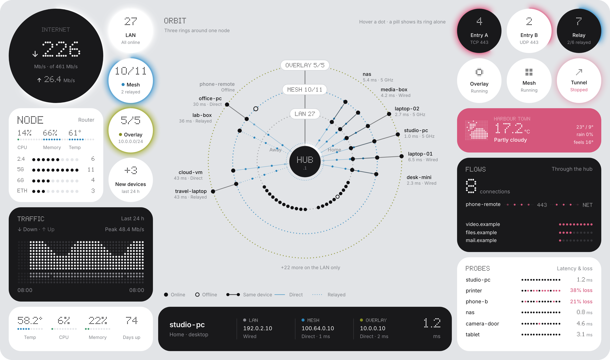
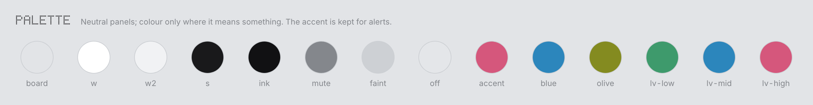
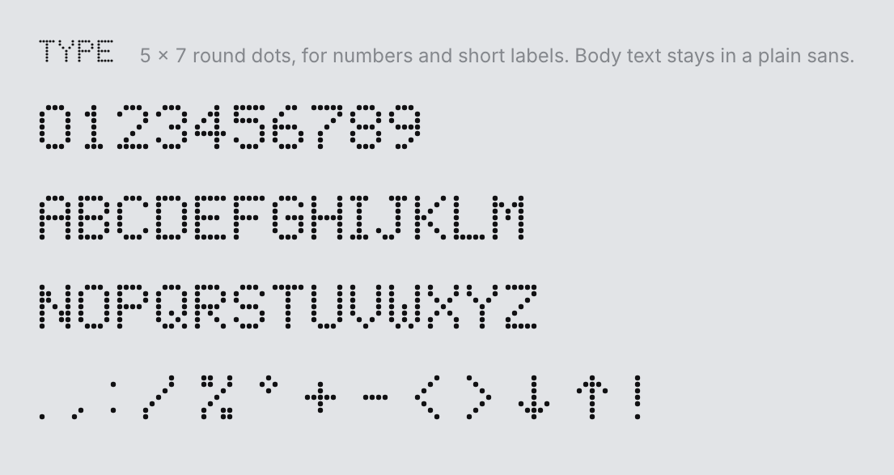
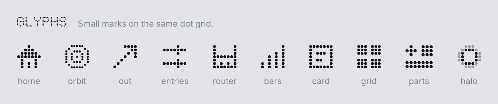
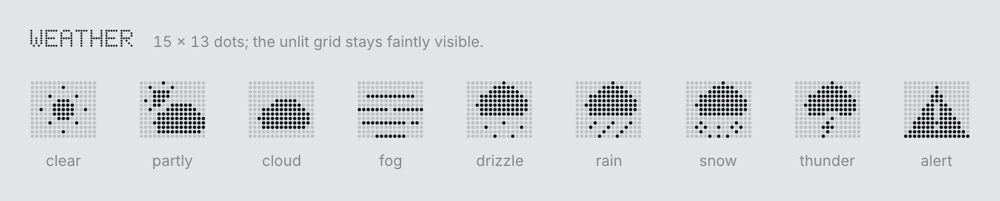
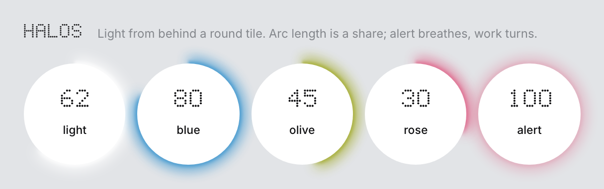
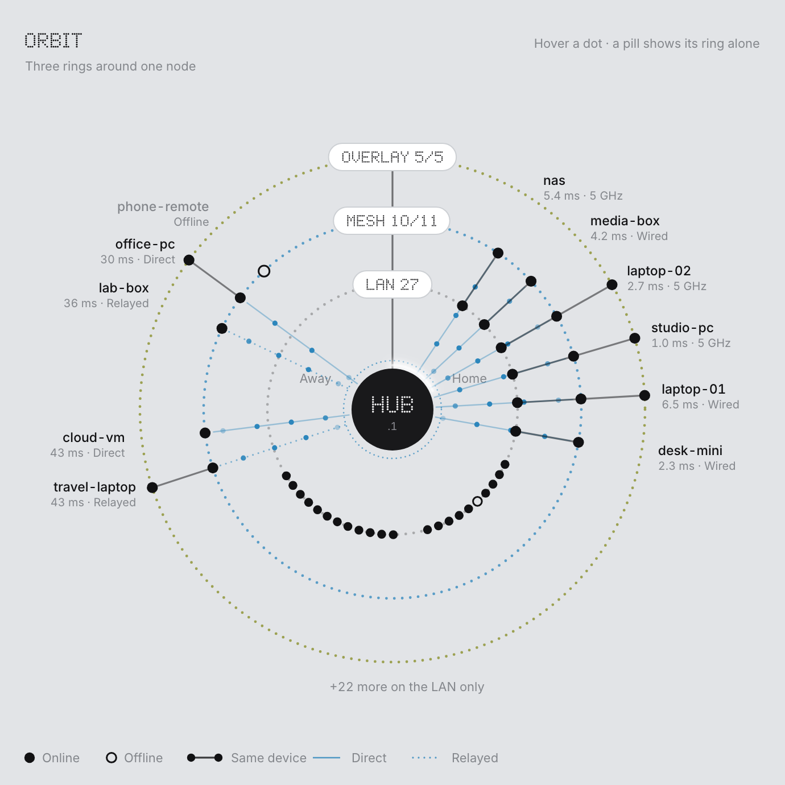

<h1 align="center">NetAtlas Kit</h1>

<p align="center">
A visual system for dense live dashboards.<br>
Round-dot type, dot charts, backlight halos, flow dots and an orbit map, on one modular grid.
</p>

<p align="center">
<a href="https://dongkunxu.github.io/netatlas-kit/"><b>Live demo</b></a>
&nbsp;·&nbsp; <a href="#quick-start">Quick start</a>
&nbsp;·&nbsp; <a href="#whats-inside">What's inside</a>
</p>

<p align="center">

</p>

<p align="center"><sub>Every tile above comes from the kit. The data is made up.</sub></p>

---

The kit is the visual layer of [NetAtlas](#origin), a home-network dashboard, published on its own.
It is plain TypeScript functions that return HTML or SVG strings, plus CSS. No framework and no
runtime dependencies, in light and dark.

## Principles

**One grid.** The board is 12 × 7 square units with 12 px gaps (one unit is 102 px at the 1360 px
design width). Every tile spans whole units: round tiles 1 × 1 or 2 × 2, panels and strips any
rectangle.

**Quiet panels.** A grey board, white tiles, a few near-black strong tiles. Colour appears only where
it means something: blue and olive mark two rings of the orbit, and the accent, cherry red, is kept
for alerts and for what needs a look.

<p align="center">
<picture>
  <source media="(prefers-color-scheme: dark)" srcset="docs/palette-dark.png">
  
</picture>
</p>

**Round dots.** Numbers and short Latin labels are set in a 5 × 7 type made of round dots: a flat
zero, three-dot tops on round letters. Names, sentences and CJK stay in a plain sans (Inter).

<p align="center">
<picture>
  <source media="(prefers-color-scheme: dark)" srcset="docs/type-dark.png">
  
</picture>
</p>

Charts, meters, load bars, marks and weather icons use the same dots.

<p align="center">
<picture>
  <source media="(prefers-color-scheme: dark)" srcset="docs/glyphs-dark.png">
  
</picture>
<br>
<picture>
  <source media="(prefers-color-scheme: dark)" srcset="docs/weather-dark.png">
  
</picture>
</p>

**Light from behind.** A round tile can glow at its edge, like LEDs under a panel. Arc length is a
share or a level, an alert breathes, ongoing work turns slowly.

<p align="center">
<picture>
  <source media="(prefers-color-scheme: dark)" srcset="docs/halos-dark.png">
  
</picture>
</p>

**A map in rings.** The orbit puts one node in the centre and three dotted rings around it. A
member is a dot on every ring it belongs to, joined by a spoke; members of the middle ring can link
into the centre, straight when direct and dotted when relayed. Angles are stable: each member keeps
its slot as others come and go.

<p align="center">
<picture>
  <source media="(prefers-color-scheme: dark)" srcset="docs/orbit-dark.png">
  
</picture>
</p>

**Movement means traffic.** Dots travel only along a drawn line, and only while something flows.
Changed digits morph dot by dot instead of redrawing.

## Quick start

```sh
git clone https://github.com/DongkunXu/netatlas-kit.git
cd netatlas-kit
npm install
npm run dev        # the demo page at http://127.0.0.1:5190
```

The same page is online at **[dongkunxu.github.io/netatlas-kit](https://dongkunxu.github.io/netatlas-kit/)**
(hover a dot in the orbit, or a pill to show its ring alone; Auto / Light / Dark at the top right).

In your own project, install it from GitHub (`npm install github:DongkunXu/netatlas-kit`) or copy
`src/` and `styles/`, then:

```ts
import "netatlas-kit/styles/kit.css";
import { boardHtml, round, dt, setHalo } from "netatlas-kit";

document.body.innerHTML = boardHtml([
  { id: "lan", area: "1 / 1 / 2 / 2", cls: "t o clk", halo: true },
]);
document.getElementById("lan")!.innerHTML = round(`<div class="v">${dt("27")}</div>`, "LAN", "All online");
setHalo("lan", { frac: 0.9, tone: "light" });
```

The modules are TypeScript source, for a bundler that compiles TypeScript (Vite, esbuild). Load
Inter, or set `--sans` to another stack. Dark mode follows the system unless
`<html data-theme="light">` or `"dark"` is set.

## What's inside

| Module | Draws |
|---|---|
| `dotfont` | `dt()` dot type for HTML (1em tall), `dtSvg()` inside SVG, `dtWidth()`; `patch()` updates a container so changed digits morph in place |
| `widgets` | `boardHtml()` the grid of tiles; `round()` a round widget; `loadBar()` and `setLoadBars()` ten-dot level bars; `meter()`, `dotBar()`, `probes()` |
| `charts` | `dotColumns()` two-sided traffic columns on a log scale; `valueColumns()` one value over time; `timeColumns()` binning; `ribbonPath()` a variable-width ribbon |
| `halo` | `haloEl()`, `setHalo()`: tones `light` `blue` `olive` `rose` `alert`, modes `steady` `breathe` `spin` |
| `flow` | `fline()` an SVG line with moving dots, `flh()` the HTML version, `flowOf()` rate to dots and speed, `setFlows()`, `startFlows()` |
| `orbit` | `orbitSvg(model)` the whole map; `placeNodes()` stable angles; `focusNode()`, `isolateRing()`, `setNodeSub()`, `setCentreHalo()`, `sizePills()` |
| `marks` | `dotMark()`, `dotMarkSvg()` pictures from rows of `#` and `o`; `dotField()` finer textures; `GLYPHS` |
| `sky` | `skyIcon()` weather icons on a 15 × 13 grid; `skyOf()` maps WMO weather codes |

| Stylesheet | |
|---|---|
| `tokens.css` | colours for light and dark, grid size, easing, font stack |
| `base.css` | text roles (`.cap` `.mute` `.warn`), dot type, segmented control, motion |
| `board.css` | `.t` tile, `.s` strong, `.sl` strong that turns light in dark mode, `.a` accent, `.o` round, `.clk` lifts on hover; round widgets, meters, load bars, charts, flow lines |
| `halo.css` `orbit.css` `window.css` `card.css` | halos, the orbit, windows over a blurred scrim, the hover card |
| `kit.css` | all of the above, in order |

### The orbit model

```ts
orbitSvg({
  rings: [
    { tone: "ink", pill: "LAN 27" },
    { tone: "blue", pill: "MESH 10/11" },
    { tone: "olive", pill: "OVERLAY 5/5" },
  ],
  linkRing: 1,
  centre: { label: "HUB", sub: ".1", halo: { frac: 0.2 } },
  nodes: [
    { id: "nas", name: "nas", sub: "1.2 ms · Wired", group: "multi", rings: [true, true, null], online: true, link: "direct" },
  ],
  text: {
    title: "ORBIT", sub: "", hint: "", home: "Home", away: "Away",
    single: (n) => `+${n} more`,
    legend: { on: "Online", off: "Offline", same: "Same device", direct: "Direct", relay: "Relayed" },
  },
});
```

- `rings` on a node, per ring: `null` not a member, `true` online, `false` offline (a hollow dot).
- `group` picks the arc: `multi` on several rings (labelled, upper right), `single` on one ring
  (bottom, named when the inner ring is isolated), `away` (labelled, left).
- `link` draws the line from the `linkRing` into the centre; `flow` names the flow riding on it.
- `card` and `linkCard` end up as `data-card` attributes, hooks for hover cards of your own.

## Origin

NetAtlas maps a home network from a Raspberry Pi: which devices are on which network, how each one
reaches the Pi, and what flows where. Its interface became this kit; the app itself stays private.

## License

[MIT](LICENSE)
